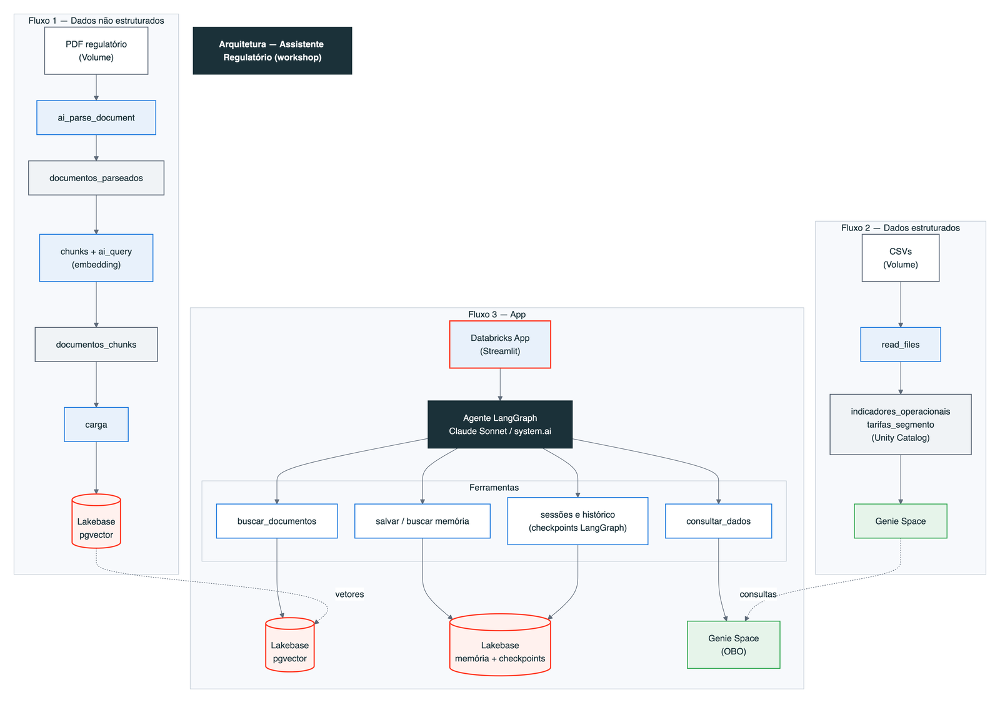

# databricks-workshop-agents-custom

Workshop Databricks (2 horas) para construir um **assistente regulatório** que combina:

- **Dados estruturados** no Unity Catalog (2 tabelas), consultados pelo **Genie** em linguagem natural.
- **Dados não estruturados** de um relatório em PDF, processados com **AI Functions** (`ai_parse_document`, `ai_query` para embeddings).
- **Lakebase** (Postgres + pgvector) como armazenamento de vetores, **sessões** e **memória** de longo prazo.
- Um **agente LangGraph** com **Claude Sonnet** (system.ai) que usa o Genie como ferramenta.
- Um **Databricks App** em Streamlit no estilo ChatGPT, com conversas anteriores na barra lateral, gráficos do Genie e autorização de usuário (**OBO**).

> Todos os dados são **fictícios**, gerados para treinamento. Não há informação real de empresa ou pessoa.

## Arquitetura



## Estrutura

```
.
├── notebook_guia_workshop.ipynb        # Guia passo a passo do workshop (roteiro principal)
├── dados/
│   ├── arquitetura.png                 # Diagrama da arquitetura do workshop
│   ├── indicadores_operacionais.csv    # 285 linhas: indicadores mensais por região (2022 a set/2026)
│   └── tarifas_segmento.csv            # 171 linhas: tarifas trimestrais por segmento e faixa
├── documentos/
│   └── relatorio_regulatorio_ficticio_2025.pdf   # Relatório de 10 páginas (texto, tabelas e gráficos em imagem)
├── app/                                # Databricks App (LangGraph + Lakebase + Genie via OBO)
│   ├── app.py                          # Interface Streamlit (chat, conversas anteriores, gráficos do Genie)
│   ├── graficos.py                     # Redesenha em Altair os gráficos gerados pelo Genie
│   ├── agente.py                       # Agente LangGraph, ferramentas e checkpointer no Lakebase
│   ├── lakebase.py                     # Conexão com o Lakebase, sessões, memória e documentos
│   ├── app.yaml                        # Configuração do app (valores a substituir marcados com xxxxxxx)
│   ├── requirements.txt
│   └── manifest.yaml
└── scripts/
    ├── gerar_dados.py                  # Gera os dois CSVs (seed fixa)
    ├── gerar_pdf.py                    # Gera o relatório em PDF (reportlab + matplotlib)
    ├── testar_agente_local.py          # Teste ponta a ponta do agente (sem a interface)
    └── assets/                         # Imagens e gráficos usados no PDF
```

## Como usar o workshop

1. Abra `notebook_guia_workshop.ipynb` no workspace Databricks e siga os blocos na ordem.
2. Carregue os CSVs de `dados/` como tabelas pela interface do Unity Catalog (**Catalog → + (Add data) → Create table**), adicionando o seu prefixo seguido de underline ao nome de cada tabela (ex.: `<prefixo>_indicadores_operacionais` e `<prefixo>_tarifas_segmento`), conforme o Bloco 2 do notebook. Ajuste a variável `VOLUME_PDF_PATH` no Bloco 1 do notebook com o path do volume dos PDFs e envie o arquivo `relatorio_regulatorio_ficticio_2025.pdf` para a raiz desse volume.
3. Crie o projeto Lakebase, o Genie Space e o app seguindo as seções correspondentes do notebook.
4. Substitua os valores `xxxxxxx` em `app/app.yaml` (principalmente `GENIE_SPACE_ID`).

Pré-requisitos: Unity Catalog, SQL Warehouse, AI Gateway, Lakebase Autoscaling e os modelos do system.ai `system.ai.claude-sonnet-5-5` (chat) e `system.ai.qwen3-embedding-0-6b` (embeddings, 1024 dimensões).

## Testar o agente localmente (opcional)

Útil para validar o código de `app/` antes do deploy. Exige Python 3.12 e as dependências de `app/requirements.txt`.

```bash
pip install -r app/requirements.txt
export DATABRICKS_CONFIG_PROFILE=<seu-profile>
export DATABRICKS_HOST=https://<seu-workspace>.cloud.databricks.com
export DEV_USER_EMAIL=<seu-email>
export DEV_USER_TOKEN=$(databricks auth token -p <seu-profile> -o json | jq -r .access_token)
export LAKEBASE_ENDPOINT=projects/workshop-agentes-<prefixo>/branches/production/endpoints/primary
export PGHOST=<host do endpoint do Lakebase>
export PGUSER=<seu-email>
export MODEL_ENDPOINT=system.ai.claude-sonnet-5-5
export EMBEDDING_ENDPOINT=system.ai.qwen3-embedding-0-6b
export GENIE_SPACE_ID=<ID do Genie Space>
export DOCUMENTOS_TABELA=documentos_chunks
python scripts/testar_agente_local.py
```

O script cria as tabelas do app, conversa em duas sessões, consulta o Genie, busca trechos do relatório, testa a memória entre sessões e recupera o histórico de uma sessão anterior.

## Regenerar os dados (opcional)

```bash
python scripts/gerar_dados.py   # CSVs em dados/
python scripts/gerar_pdf.py     # PDF em documentos/ (requer reportlab e matplotlib)
```

## Aviso

Os nomes de empresas, agências, cidades e pessoas são fictícios. Qualquer semelhança com entidades reais é coincidência.
